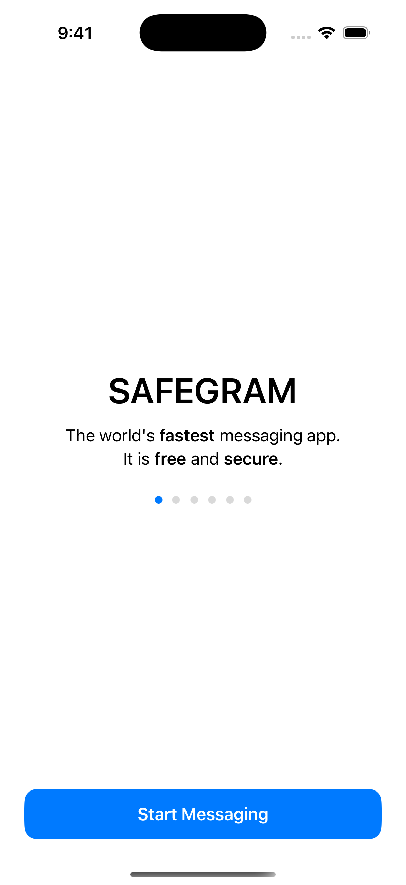
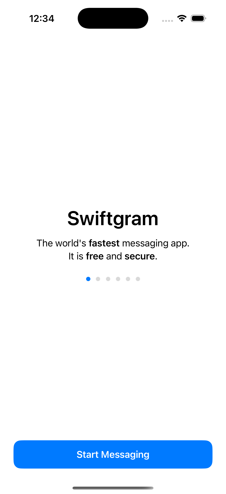

# SAFEGRAM iOS v0.4 — реальные экраны и состояние

Ниже **настоящие скриншоты из iOS Simulator**, а не придуманный дизайн. Вход в Telegram, чаты после входа и установка на iPhone этими кадрами **не подтверждены**.

## 7 октября 2026: SAFEGRAM после исправления названия

Сборка/запуск на iPhone 16 Pro Simulator: GitHub Actions run 37597828235. На этом экране видны SAFEGRAM и Start Messaging. Скриншот показывает только приветствие до входа в Telegram.

## 6 октября 2026: до исправления

Ранее отображалось старое название Swiftgram. Исправление было проверено отдельным Simulator smoke.

## Что уже есть в исходниках

- [SAFEGRAM Security Center](../overlay/Swiftgram/SafeGramUI/Sources/SafeGramSecurityCenterController.swift): переключатели Message Forensics и Identity Fingerprint, блокировка Safe Exit, история событий/находок.
- [Threat Engine](../overlay/Swiftgram/SafeGramCore/Sources/SafeGramThreatEngine.swift): код оценки угроз.
- [Forensics](../overlay/Swiftgram/SafeGramCore/Sources/SafeGramForensics.swift): журнал и экспорт событий.
- [Identity Monitor](../overlay/Swiftgram/SafeGramCore/Sources/SafeGramIdentityMonitor.swift): отслеживание идентичности.
- [Настройки](../overlay/Swiftgram/SafeGramCore/Sources/SafeGramSettings.swift): локальные настройки SAFEGRAM.

**Статус:** наличие исходного кода и успешная сборка — не то же самое, что проверенная работа функций на iPhone после авторизации.

## Проверенное и непроверенное

| Проверка | Фактический статус |
|---|---|
| Архивный overlay v0.4 / pinned upstream | исходники зафиксированы |
| Сборка и запуск iOS Simulator | PASS |
| Отображение имени SAFEGRAM на приветствии | PASS |
| Создание ARM64 IPA | PASS — unsigned, compile-test credentials |
| Windows видит iPhone по USB | PASS |
| Sideloadly обнаруживает iPhone | PASS |
| Подпись Apple ID и установка IPA | НЕ ПОДТВЕРЖДЕНО |
| Реальный вход в Telegram | НЕ ПОДТВЕРЖДЕНО, собственных API-ключей нет |
| Чаты, звонки, SafeGram Security Center на устройстве | НЕ ПРОВЕРЕНО |

Рабочая ветка клиента: `local/brandfix-v04`; последний hardening-коммит `5ce30cf`.
Облачные проверки: https://github.com/mrirodovskiy97-hash/SAFEGRAM-iOS-CI/actions/runs/37597828235

Эта папка добавлена только для визуальной проверки. Она не меняет клиент, workflow или сборку.
